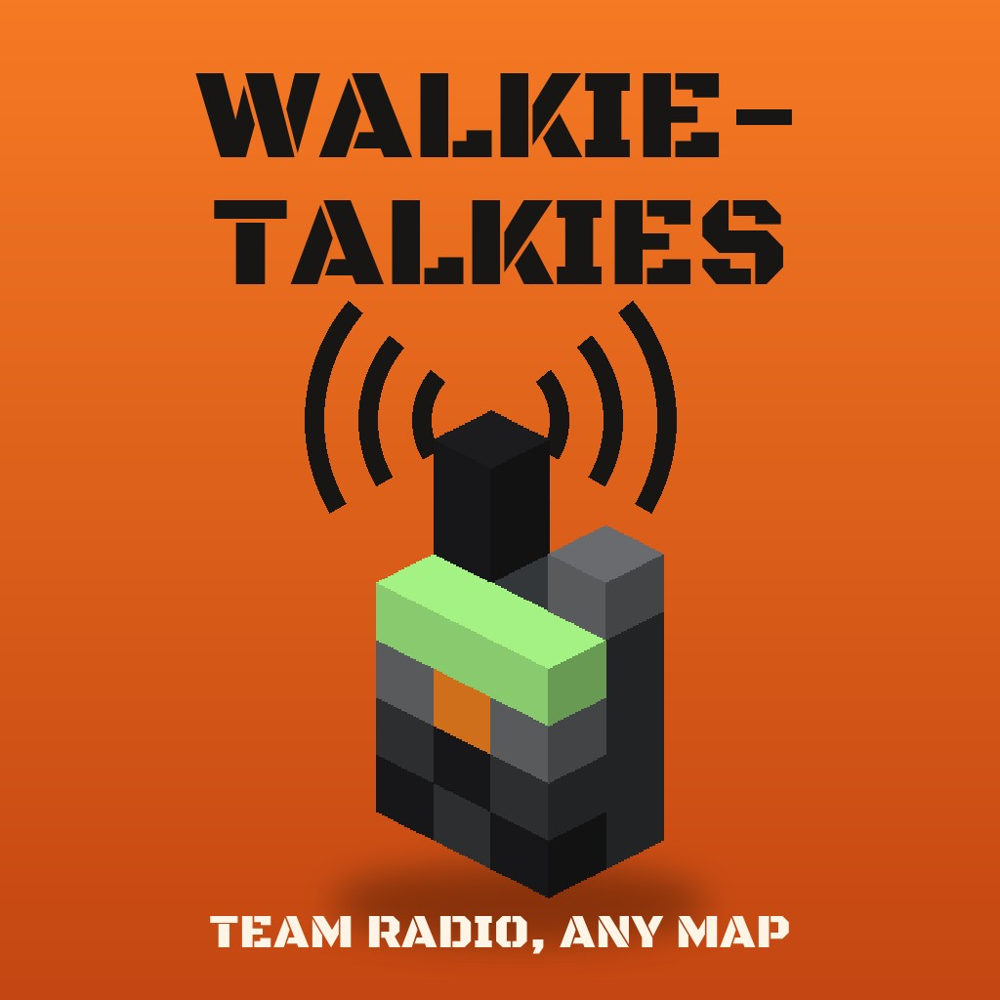

# Walkie-Talkies - team radio on any map



On the Steam Workshop: [Walkie-Talkies](https://steamcommunity.com/sharedfiles/filedetails/?id=3833289690)

Everyone gets a walkie-talkie in their item wheel. Hold it and talk: everyone else carrying one hears you, wherever they are on the map. Game modes and maps can split the players into teams, so a team only hears its own players.

**Needs [Proximity Comms](https://steamcommunity.com/sharedfiles/filedetails/?id=3812301496)** for the talking (voice and typed chat). Without it the walkie-talkie is just a prop and nothing breaks.

## How to use it
- Pick the **Walkie-talkie** from your item wheel and hold it. While it's in your hand and switched on, what you say (or type) goes out on it.
- **Right mouse button** switches it off and on.
- Put it away and you still hear the others: the walkie on your belt plays them, and players standing next to you can overhear it.
- Lost yours? Press **E** on one lying around. Maps can place them, and the host can spawn them (Tools > Walkie-talkie).
- You get a new one after every respawn. It also works under water with [Underwater Exploration](https://steamcommunity.com/sharedfiles/filedetails/?id=3829332491).

## Multiplayer
The host turns it on under Global mods, together with Proximity Comms. Without teams, everyone shares one channel.

## Teams (for game mode and map makers)
Teardown has no team setting other mods can see: a game mode's teams (mplib's teams.lua included) live inside its own script. So you tell the walkie-talkies who is on which team with one registry key per player, from your **server** script (on the host), whenever teams change:

```lua
SetString("walkie.team." .. player, "red")   -- red's walkies only hear red
SetString("walkie.team." .. player, "")      -- back on the shared channel
```
- Any team name works: letters, digits, - and _ (case doesn't matter).
- If you already set Proximity Comms' `proxchat.team.<player>` (its pings use it), the walkie-talkies follow that too. `walkie.team` wins when both are set.
- With mplib, for example, each tick for every player p: 
```lua
local t = teamsGetTeamId(p)   -- 0: no team yet
SetString("walkie.team." .. p, t > 0 and "team" .. t or "")
```

Other keys (host, server script):
- `walkie.give.<player>` = 1 hands one out (in hand); 0 takes it away for good (none at respawns).
- `walkie.start` = 0 (set it in your init): nobody gets one at the start, only from the ones lying around.
- A map places them with any body tagged **walkie** (add **remain** to keep it there when taken).

## Install

Subscribe on the [Steam Workshop](https://steamcommunity.com/sharedfiles/filedetails/?id=3833289690), or clone this repository into
`Documents/Teardown/mods/walkie talkie`. Enable it under **Global mods** (in multiplayer the host does).

## Credits

Made by AgeOfAlgorithms and Claude (Anthropic). MIT licence.
